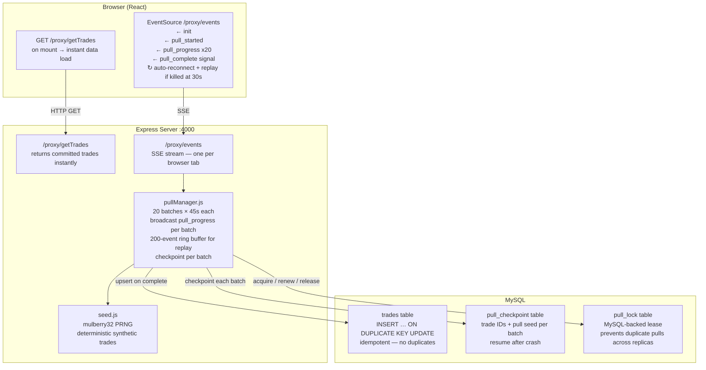
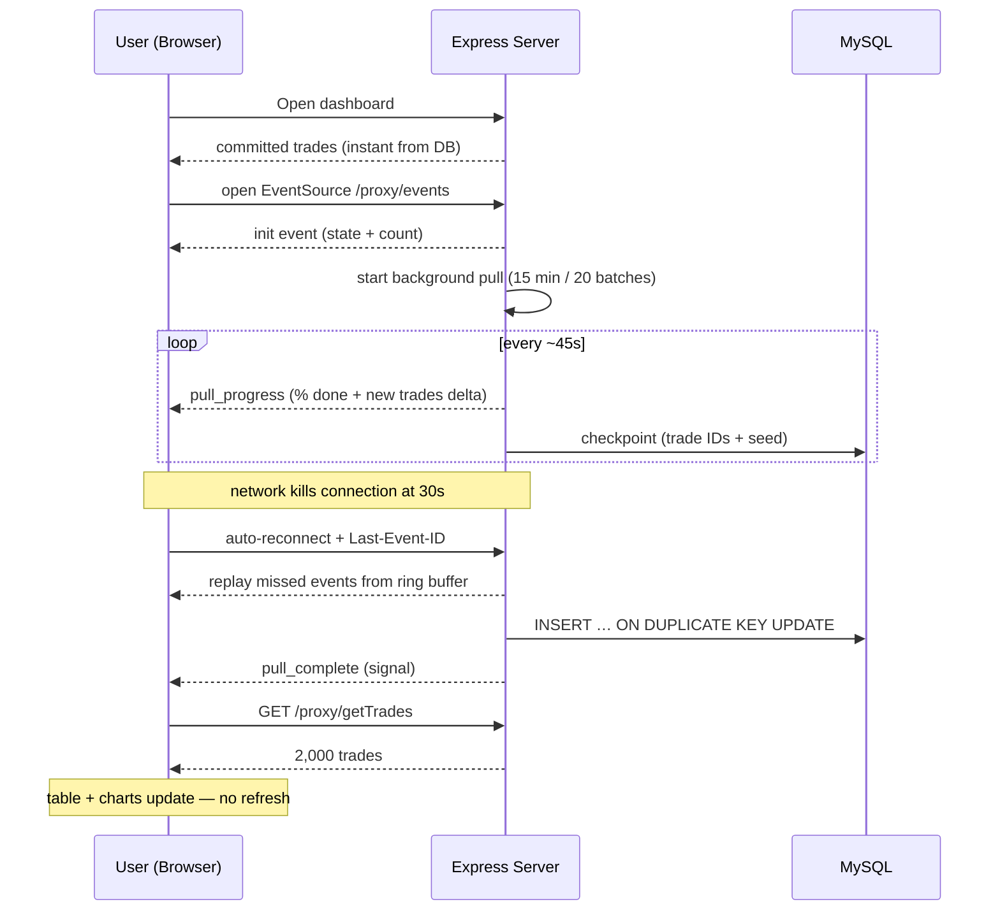

# Architecture Note

## The Problem

| | |
|---|---|
| Pull duration | up to 15 minutes |
| Network timeout | 30 seconds (kills any open HTTP connection) |
| Dashboard must | open instantly, update automatically on pull complete |

The classic approach — hold one HTTP request open for 15 minutes — is impossible here.

---

## Why Server-Sent Events (SSE)?

| Option | Stays under 30s? | Auto-reconnect? | Complexity | Correct? |
|---|---|---|---|---|
| Long-poll HTTP | ✗ connection dies | Manual | Medium | ✗ |
| Polling (interval) | ✓ but this is polling | N/A | Low | ✗ banned |
| WebSockets | ✓ but overkill | Manual | High | ✓ |
| **SSE (chosen)** | **✓** | **Built-in** | **Low** | **✓** |

SSE is HTTP/1.1-compatible, unidirectional (server→client, which is all we need), and the browser's `EventSource` API reconnects automatically. On reconnect it sends `Last-Event-ID` so the server can replay any missed events.

---

## System Design

---

## Data Flow (happy path)

---

## Persistence & Resume

- **Idempotent writes:** trades upserted with `INSERT … ON DUPLICATE KEY UPDATE` keyed on `trade_id`. Re-running a pull updates rather than duplicates.
- **Checkpoint:** each batch saves only the staged trade IDs + the pull seed to the `pull_checkpoint` table (compact — IDs only, not full trade objects).
- **Resume:** on restart, the server regenerates trades from the **stored seed** and resumes from the last saved batch. Using the stored seed keeps data consistent even if the restart crosses a 5-minute seed boundary.

---

## Pull Concurrency (horizontal scaling)

- **Single instance (dev):** in-memory `pullStatus.state === "running"` flag.
- **Multiple replicas (production):** a MySQL-backed lease (`pull_lock` table) — a replica only starts a pull if the lock is unheld or its lease has expired. The lease is renewed each batch and released on completion/failure.

---

## Why not WebSockets?

WebSockets are bidirectional and require a protocol upgrade. For a strictly server-push use case, SSE is simpler, works over plain HTTP/1.1, and the browser handles reconnection natively.

## Why not polling?

Explicitly banned by the brief. Polling also lags behind the real completion by up to one poll interval and wastes bandwidth.
