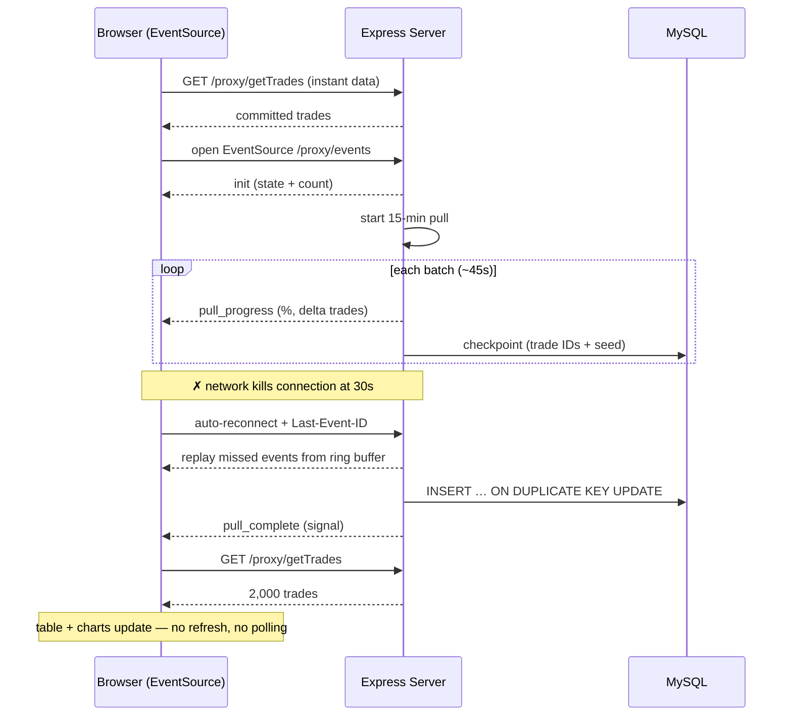
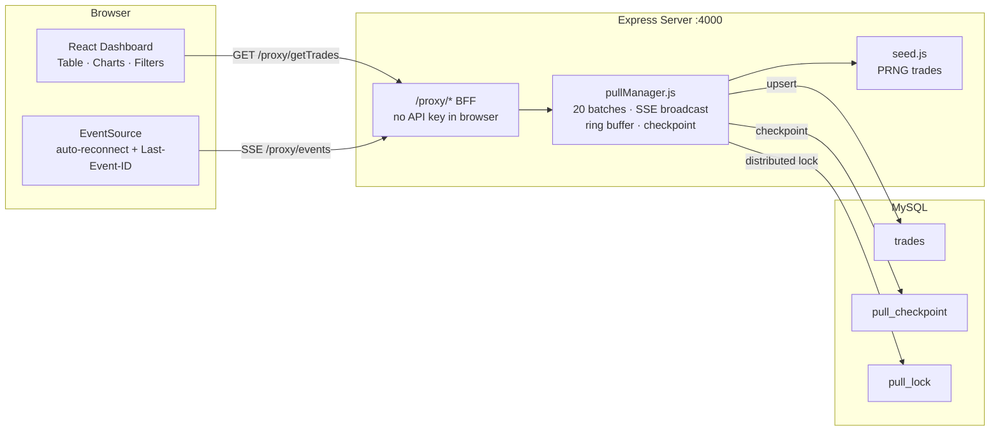

# BSE Trades Dashboard — Problem & Solution Report

Plain-language explanation of the problem, why it's hard, and exactly how it's solved.

---

## TL;DR

The app fetches ~2,000 stock trades in a job that takes **up to 15 minutes**. But the network **kills any connection open longer than 30 seconds**. The dashboard still has to open instantly and update by itself when done — no polling, no refresh. Solved with **Server-Sent Events (SSE)**: a live channel the browser auto-reconnects, and the server replays anything missed.

---

## 1. The Problem

> **A full pull takes up to 15 minutes, but the network kills any HTTP connection held open longer than 30 seconds. The dashboard must open instantly and update automatically — no polling, no page refresh.**

Two facts fight each other:

- The pull takes **up to 15 minutes**
- The network **cuts any connection at 30 seconds**

Holding one HTTP request open for 15 minutes = impossible.

### Requirements

1. Dashboard opens **instantly**
2. Updates **automatically** when pull finishes
3. **No polling** (no `setInterval` asking "done yet?")
4. **No page refresh**

---

## 2. Why the Obvious Approaches Don't Work

| Approach | Stays under 30s? | Auto-reconnect? | No polling? | Verdict |
|---|:---:|:---:|:---:|:---:|
| Long-poll HTTP | ✗ killed at 30s | manual | ✓ | ✗ impossible |
| Polling | ✓ | N/A | ✗ banned | ✗ |
| WebSockets | ✓ | manual | ✓ | works but overkill |
| **SSE** | **✓** | **built-in** | **✓** | **✅ chosen** |

---

## 3. The Solution: Server-Sent Events

Instead of holding one connection open, the server:

1. **Drips the pull in 20 batches** (~45s each)
2. **Broadcasts each batch** as a `pull_progress` SSE event to all open tabs
3. When the connection is **killed at 30s**, the browser **reconnects in 3s** and sends `Last-Event-ID`
4. The server **replays missed events** from a 200-event ring buffer
5. On completion, sends a `pull_complete` signal and the browser re-fetches via REST

---

## 4. Diagrams

### 4.1 Timeline: pull vs killed connection

```mermaid
gantt
    title Pull timeline vs SSE connection kills
    dateFormat X
    axisFormat %ss

    section Pull (20 batches)
    batch 1-5   : 0, 225
    batch 6-10  : 225, 450
    batch 11-15 : 450, 675
    batch 16-20 : 675, 900

    section SSE Connection
    connected   : 0, 30
    reconnect   : 30, 33
    connected   : 33, 63
    reconnect   : 63, 66
    connected   : 66, 96
    reconnect   : 96, 99
```



### 4.2 Sequence: reconnect & replay



### 4.3 System architecture



---

## 5. The Moving Parts

| File | Role |
|---|---|
| `pullManager.js` | Background pull job, SSE broadcast, ring buffer, checkpoint per batch |
| `seed.js` | Generates 2,000 deterministic synthetic BSE trades |
| `/proxy/events` | SSE endpoint (BFF — no API key needed in the browser) |
| `useTrades.js` | React hook: opens EventSource, handles reconnect, re-fetches on `pull_complete` |
| MySQL | Idempotent upserts + checkpoint for crash resume + distributed lock |

### Crash resume

If the server dies mid-pull, it saves a checkpoint (trade IDs + pull seed) each batch. On restart it regenerates trades from the **same seed** and resumes from the last batch — no data loss, no restart from zero.

---

## 6. How to Demo It

Speed up the pull to 60 seconds so it's watchable:

```powershell
$env:PULL_DURATION_MS = "60000"
npm run dev
```

Open **http://localhost:5173** and:

1. Dashboard loads instantly
2. Progress bar fills automatically (~60s)
3. At 100% — trades appear in the table and charts **by themselves**, no refresh
4. Show filters, sort, charts
5. Click **New Pull** to repeat

> *"The data updates by itself, in real time, without refreshing the page — that's what this app was built to solve."*

---

## 7. Why This Is the Right Answer

- Stays under the 30s limit — no long-held connection
- No polling — server pushes, browser listens
- No data lost — ring buffer replays the gap after any kill
- Instant open — committed data served from DB immediately
- Crash-safe — checkpoint + idempotent writes, restart resumes not restarts
- Simple — plain HTTP/1.1, browser handles reconnection natively
