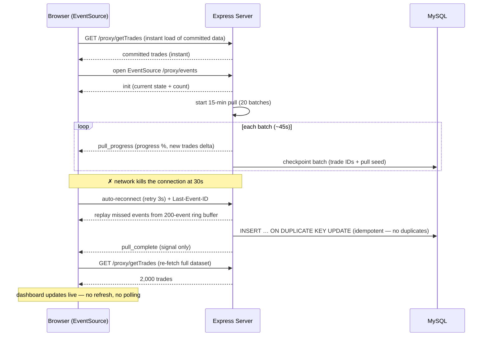

# BSE Trades Dashboard — Problem & Solution Report

A plain-language explanation of the problem this project solves, why it's hard,
and exactly how it's solved — with diagrams.

---

## TL;DR

The app has to fetch a big batch of stock-trades data that takes **up to 15 minutes**
to complete. But the network **kills any single connection that stays open longer than
30 seconds**. So you can't just hold one connection open for 15 minutes. The dashboard
still has to **open instantly** and **update by itself** when the pull finishes — no
polling, no page refresh. The project solves this with **Server-Sent Events (SSE)**:
a live channel the browser auto-reconnects when the network drops it, and the server
replays anything that was missed.

---

## 1. The Problem Statement

> **A full pull takes up to 15 minutes, but the network kills any HTTP connection held
> open longer than 30 seconds. The dashboard must open instantly and update
> automatically when the pull completes — no polling, no page refresh.**

### The tension that makes it a real problem

Two facts fight each other:

- The **pull** (fetching/generating ~2,000 stock trades) takes **up to 15 minutes**.
- The **network kills any single connection open longer than 30 seconds**.

So the naive approach — open one HTTP request and stream data down it for 15 minutes —
is **impossible**: the connection gets cut at the 30-second mark.

### The requirements

1. The dashboard must **open instantly** and show data right away.
2. It must **update automatically** when the pull finishes.
3. **No polling** (the browser can't just ask "done yet?" every few seconds).
4. **No page refresh** required by the user.

---

## 2. Why the Obvious Approaches Don't Work

| Approach | Stays under 30s? | Auto-reconnect? | No polling? | Verdict |
|----------|:---:|:---:|:---:|:---:|
| **Long-poll HTTP** (hold one request open for the whole pull) | ✗ killed at 30s | manual | ✓ | ✗ impossible |
| **Polling** (browser asks "done yet?" every few seconds) | ✓ | N/A | ✗ banned + laggy | ✗ |
| **WebSockets** (two-way live channel) | ✓ | manual | ✓ | works, but overkill |
| **SSE — Server-Sent Events** ✅ | ✓ | **built-in** | ✓ | ✅ chosen |

- **Long-polling** is dead on arrival — one open request gets killed at 30s.
- **Polling** stays under the limit but is explicitly banned by the brief, and it makes
  the dashboard lag behind the real completion by up to one poll interval.
- **WebSockets** would work, but they're bidirectional (we only need server→browser),
  need a protocol upgrade, and require you to build reconnection by hand. Overkill here.
- **SSE** is plain HTTP/1.1, one-way (exactly what we need), and the browser's
  `EventSource` API **reconnects automatically** and remembers where it left off.

---

## 3. The Solution: Server-Sent Events

### The core idea

Instead of holding one connection open for 15 minutes, the server:

1. **Drips the pull in 20 batches** (~45 seconds each), so progress comes in pieces.
2. **Broadcasts each batch as an SSE event** (`pull_progress`) to every open browser tab.
3. When the browser's connection is **killed at 30s**, the browser **reconnects on its own**
   (after a 3-second retry) and tells the server the **last event it received**.
4. The server **replays the missed events** from a 200-event ring buffer — nothing is lost.
5. When the pull finishes, the server sends a `pull_complete` **signal**, and the browser
   **re-fetches the full dataset** via a normal REST request. The dashboard updates live.

### Why this beats the 30-second kill

The connection getting killed no longer matters, because:

- The browser **reconnects automatically** — no user action, no code to write for that.
- The server **remembers recent events** (ring buffer) and **replays the gap** on reconnect.
- Progress is sent in **small chunks** (one event per batch), so a killed connection only
  loses a few seconds of progress, which is replayed immediately after reconnect.

---

## 4. Diagrams

### 4.1 Timeline: the pull vs. the killed-and-reconnecting connection

```
PULL (15 min total — 20 batches of ~45s each):
 ┌────────┬────────┬────────┬─────────────────┬────────┐
 │ batch1 │ batch2 │ batch3 │      ……          │ batch20│ → commit to DB
 └───┬────┴───┬────┴───┬────┴─────────────────┴───┬────┘
     │        │        │                          │
     ▼        ▼        ▼                          ▼
 progress  progress  progress        ……        pull_complete
  event     event     event                    (signal)
                                                       │
SSE CONNECTION (browser side):                          ▼
 ════════╗  ✗ KILL @30s        ════════╗  ✗ KILL @30s   browser re-fetches
  open    │                    open    │                 full dataset
   ▼      ▼  ↻ reconnect+replay ▼      ▼  ↻ reconnect      via REST
  init   progress gap replayed  progress gap replayed
         (Last-Event-ID)        (Last-Event-ID)

   t=0s      t=30s  t=33s         t=63s  t=66s   …   t=15m
```

Reading the diagram: the **pull** marches across the top in 20 batches, emitting a
progress event each time. The **SSE connection** (bottom) keeps getting killed at the
30-second mark, but the browser reconnects 3 seconds later and the server replays the
few events it missed. At the end, `pull_complete` is just a signal — the browser then
does one normal request to load all the trades.

### 4.2 Sequence: reconnect & replay under the 30s kill



### 4.3 System architecture

```
┌──────────────────────────────────────────────────────────┐
│                        Browser (React)                    │
│                                                            │
│   GET /proxy/getTrades  ─► instant data on open           │
│   EventSource /proxy/events                                │
│      ◄─ init, pull_started, pull_progress, pull_complete  │
│      ◄─ (auto-reconnect + replay if killed at 30s)        │
└──────────────────────────────────────────────────────────┘
                          │  HTTP (BFF — no key in browser)
┌──────────────────────────────────────────────────────────┐
│                  Express Server (:4000)                   │
│   /proxy/getTrades  ─► committed trades (instant)         │
│   /proxy/events     ─► SSE stream, one per tab            │
│   pullManager.js    ─► 15-min pull, 20 batches, broadcast │
│                        + 200-event ring buffer (replay)   │
│                        + checkpoint per batch (resume)     │
│   seed.js           ─► deterministic synthetic trades      │
└──────────────────────────────────────────────────────────┘
                          │
┌──────────────────────────────────────────────────────────┐
│   MySQL  ─► idempotent upserts (INSERT … ON DUPLICATE KEY UPDATE) │
│             + pull_checkpoint (resume after crash)        │
└──────────────────────────────────────────────────────────┘
```

---

## 5. The Moving Parts

| Piece | Role |
|-------|------|
| `pullManager.js` | Runs the 15-min pull in batches, broadcasts SSE events, keeps the ring buffer for replay, checkpoints each batch. |
| `seed.js` | Generates ~2,000 deterministic synthetic trades (the stand-in for the real BSE feed). |
| `/proxy/events` | The SSE endpoint the browser uses (BFF — no API key needed in the browser). |
| `useTrades.js` | The React hook that opens the EventSource, handles reconnect, and re-fetches on `pull_complete`. |
| MySQL | Stores committed trades with idempotent upserts (re-running a pull never duplicates) and a checkpoint so a crashed pull can resume. |

### Bonus: survives a crash mid-pull

If the server dies halfway through the 15-minute pull, it doesn't start over. Each batch
saves a **checkpoint** (just the trade IDs + the pull's seed). On restart it regenerates
the trades from that same seed and resumes from the last batch — so resumed data stays
consistent even if the restart crosses a 5-minute seed boundary.

---

## 6. How to Demo It

The default 15-minute pull is too slow to watch, so speed it up for a demo:

```powershell
$env:PULL_DURATION_MS = "30000" # 30-second pull so the demo moves fast
npm run dev
```

Then open **http://localhost:5173** and:

1. The dashboard opens instantly with the committed trades.
2. A pull auto-starts — watch the progress bar fill.
3. At 100%, ~2,000 trades appear in the table and charts **by themselves** (no refresh).
4. Show filters, sortable columns, paging, and the charts.
5. Click **New Pull** to run it again.

The one line to say while it runs: *"the data updates by itself, in real time, without
refreshing the page — that's exactly the problem this app was built to solve."*

---

## 7. Why This Is the Right Answer

- **Stays under the 30s limit** — no single connection is held open for 15 minutes.
- **No polling** — the server pushes; the browser just listens.
- **No data lost** — auto-reconnect + ring-buffer replay fill the gap after a kill.
- **Instant open** — committed data is served from the DB immediately.
- **Crash-safe** — checkpoint + idempotent writes mean a restart resumes, never duplicates.
- **Simple** — plain HTTP/1.1 SSE, no protocol upgrade, reconnection handled by the browser.
